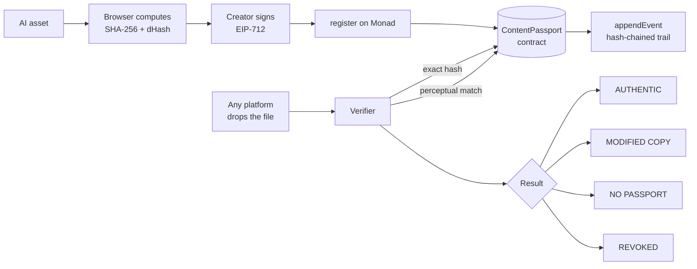

# ProvenanceX

**On-chain Content Passports for AI-generated assets, built on Monad.**
Every AI-generated file gets a cryptographic certificate of origin and a tamper-evident audit trail. Drop the file into a verifier on *any* platform and see who made it, with which tool, when, how it was edited, and whether it has been altered.

> Built for **Monad Blitz Pune V3** (10 Oct 2026).

---

## Quick links (fill every `TODO` before submitting)

| What | Link |
|---|---|
| Live app | TODO: https://your-app.vercel.app |
| Public repo | TODO: https://github.com/YOUR_USER/provenancex |
| Contract (Monad Testnet) | TODO: `0x...` ([explorer](https://testnet.monadexplorer.com/address/0x...)) |
| Contract source verified | TODO: explorer link to verified source |
| Contract (Monad Mainnet, bonus) | TODO: `0x...` or "not deployed" |
| Custom domain (bonus) | TODO: https://... or "none" |
| Demo video (30s+) | TODO: link |
| Ad video | TODO: link |
| Social posts | TODO: X link, LinkedIn link |
| Demo transactions | TODO: tx hashes for register / append event |

**Network:** Monad Testnet, chain ID `10143`, RPC `https://testnet-rpc.monad.xyz`, currency MON, explorer `https://testnet.monadexplorer.com`. Confirm current values at [docs.monad.xyz](https://docs.monad.xyz).

---

## 1. The problem

AI images, video, and audio spread across platforms with no reliable record of their origin. Metadata is stripped on upload, screenshots erase it, and centralized registries do not travel between platforms. Platforms, creators, and regulators cannot answer a simple question: *who made this, and has it been changed?*

## 2. The solution

ProvenanceX registers a fingerprint of each asset on Monad together with a signature from its creator.

- **Certificate of origin:** creator address, tool used, and timestamp, signed with EIP-712 and stored on-chain.
- **Tamper evidence:** the file's SHA-256 hash is registered. Change one pixel and the hash no longer matches.
- **Survives re-encoding:** a 64-bit perceptual hash (dHash) lets the verifier flag *modified or re-encoded copies* of a registered asset.
- **Audit trail:** every later event (edit, upscale, license change) is appended to a hash chain, so history cannot be quietly rewritten.
- **Lineage:** derivative works link to their parent passport.
- **Verify anywhere:** a public page per passport, an embeddable badge, and a JSON API for platforms.

## 3. How it works



**Verification outcomes**

| Result | Meaning |
|---|---|
| 🟢 AUTHENTIC | Exact SHA-256 match to a registered, non-revoked passport |
| 🟡 MODIFIED / RE-ENCODED COPY | No exact match, but perceptual distance to a passport is 6 or less |
| 🔴 NO PASSPORT FOUND | No exact or similar match on-chain |
| ⚪ REVOKED | Matching passport was revoked by its creator |

## 4. Smart contract

`contracts/src/ContentPassport.sol` (Solidity ^0.8.24, OpenZeppelin `EIP712` + `ECDSA`).

| Function | Caller | Purpose |
|---|---|---|
| `register(contentHash, perceptualHash, tool, metadataURI, parentId, sig)` | Anyone (signs as themselves) | Creates a passport. First creator of a given hash wins. Verifies the EIP-712 signature. |
| `appendEvent(passportId, eventType, dataHash)` | Creator or authorized operator | Adds an event; `trailHead = keccak256(trailHead, eventType, dataHash, timestamp)` |
| `authorize(passportId, operator, allowed)` | Creator | Grants or removes operator rights |
| `revoke(passportId)` | Creator | Marks the passport revoked |
| `verifyByHash(contentHash)` | View | Returns existence, passport ID, and passport data |
| `getPassport(passportId)` | View | Full passport record |
| `getChildren(passportId)` | View | Derivative passports |
| `totalPassports()` / `getPage(offset, limit)` | View | Paged listing used for perceptual matching without log scans |
| `hammingDistance(a, b)` | Pure | Bit distance between two perceptual hashes |

**Events:** `PassportRegistered`, `TrailEvent`, `OperatorSet`, `Revoked`.
**Custom errors:** `AlreadyRegistered`, `ParentNotFound`, `Unauthorized`, `InvalidSignature`, `Revoked`, `StringTooLong`.

## 5. Features by page

| Route | What it does |
|---|---|
| `/` | Pitch, three-step explainer, live passport counter |
| `/create` | Upload or generate an image, hash it, sign, register, download the passported file and certificate card (QR) |
| `/verify` | Drop any file to get a verification result |
| `/p/[id]` | Public passport page: details, audit trail with client-side hash-chain check, lineage, embeddable badge |
| `/demo` | Guided four-step demo with a live transaction feed |
| `/api/verify?hash=0x...` | JSON endpoint for platform integrations |

## 6. Run it yourself

### Prerequisites

- Node.js 20+
- [Foundry](https://book.getfoundry.sh/getting-started/installation) (`curl -L https://foundry.paradigm.xyz | bash && foundryup`)
- A browser wallet (MetaMask or similar)
- Testnet MON from the Monad faucet (see [docs.monad.xyz](https://docs.monad.xyz))

> Use a **burner wallet** for testnet. Never use a wallet that holds real funds.

### Step 1: clone and configure

```bash
git clone TODO_REPO_URL provenancex
cd provenancex
cp .env.example .env
```

Edit `.env`:

```
PRIVATE_KEY=0xYOUR_BURNER_PRIVATE_KEY
MONAD_TESTNET_RPC=https://testnet-rpc.monad.xyz
NEXT_PUBLIC_CHAIN_ID=10143
NEXT_PUBLIC_CONTRACT_ADDRESS=0xDEPLOYED_ADDRESS
NEXT_PUBLIC_DEPLOY_BLOCK=0
# Optional, testnet-only convenience for demos (burner key, never real funds):
# NEXT_PUBLIC_DEMO_KEY=0x...
```

### Step 2: test the contracts

```bash
cd contracts
forge install
forge build
forge test -vv
forge coverage
```

### Step 3: deploy (skip if you just want to use our deployed contract)

```bash
forge script script/Deploy.s.sol \
  --rpc-url $MONAD_TESTNET_RPC \
  --broadcast
```

Copy the printed contract address into `NEXT_PUBLIC_CONTRACT_ADDRESS` (and `web/src/lib/deployment.json`). Verify the source following the Monad docs and add the explorer link to this README.

### Step 4: run the app

```bash
cd ../web
npm install
npm run dev
```

Open http://localhost:3000.

### Step 5: use it

1. Connect your wallet. If prompted, switch to Monad Testnet (the app adds the network for you).
2. Open `/demo` and follow the four numbered buttons, or:
3. Go to `/create`, upload an image, choose the tool name, click **Sign & Register**, and approve the transaction.
4. Download the passported file, then open `/verify` and drop it. You should see 🟢 AUTHENTIC.
5. Change the file (or press **Tamper** in `/demo`) and verify again. You should see 🟡 or 🔴.

### Step 6: deploy the frontend

```bash
cd web
npx vercel --prod
```

Set the same `NEXT_PUBLIC_*` variables in the Vercel project settings.

### Troubleshooting

| Problem | Fix |
|---|---|
| Wallet on the wrong network | Click "Switch to Monad Testnet" in the app header |
| Transaction fails with insufficient funds | Get testnet MON from the faucet |
| `AlreadyRegistered` error | That exact file already has a passport. Use `/verify`, or register a derivative with a parent ID |
| Slow or failing reads | Public RPCs rate-limit. Retry, or set a different RPC in `.env` |
| Image generation fails | Use the upload option or the bundled samples in `web/public/samples` |

## 7. Demo script (3 minutes)

| Time | Action | Result |
|---|---|---|
| 0:00 | Pitch: say repo link, contract address, live URL, deployment | Landing page |
| 0:20 | Generate, sign, register (live tx) | Tx confirmed in about a second, certificate card with QR |
| 1:00 | Open the "OtherSite" verifier, drop the downloaded file | 🟢 AUTHENTIC |
| 1:30 | Flip one pixel, verify again | 🔴 / 🟡 mismatch explained |
| 2:00 | Append a derivative edit event (live tx), open `/p/[id]` | Trail grows, hash chain verified |
| 2:30 | Business close | API, badge, pricing |

## 8. Decisions and trade-offs

- **Paged reads instead of `eth_getLogs` scans.** Public RPCs often restrict log ranges, so the contract exposes `getPage` and the frontend computes perceptual distance locally.
- **First creator wins.** The first registration of a given content hash owns it. This proves *earliest registration*, not legal authorship.
- **Perceptual hash is a heuristic.** dHash detects light re-encoding, resizing, and compression. Heavy crops or edits can defeat it; those cases are treated as new works or derivatives.
- **Hashes, not files, on-chain.** Assets never leave the user's browser unless they choose to host them. Only hashes, a tool tag, and optional metadata URI are stored.
- **Trail integrity is client-verifiable.** The UI recomputes the hash chain from events and compares it to the on-chain `trailHead`.
- **Demo key fallback.** An optional testnet-only burner key keeps the live demo alive if a wallet popup fails. It is off by default.
- **Known limitations:** provenance proves registration and integrity, not that an asset is "truly AI-made." Pair it with signed attestations from generation tools for stronger claims.

## 9. Why Monad

- **Sub-second finality:** registration feels like a normal app action, not a wait.
- **Low fees and high throughput:** registering every generated asset and every edit is economically practical.
- **EVM compatible:** standard Solidity and viem/wagmi tooling.
- **Native P256 precompile (roadmap):** passkey signing (Face/Touch ID) can verify on-chain cheaply at `0x0100`.

## 10. Business model

| Stream | Description |
|---|---|
| Per-asset registration fee | Tiny fee per passport, paid by creators or generation platforms |
| Enterprise verification API | Hosted `/api/verify`, SLAs, bulk lookups for platforms and newsrooms |
| Embeddable badge / SDK | Drop-in "verified origin" widget for marketplaces and social apps |
| Compliance tooling | Audit exports for teams that must label AI content |

## 11. Roadmap

- [ ] Passkey signing via Monad P256 precompile
- [ ] Signed attestations from AI tools and C2PA manifest import/export
- [ ] Video and audio perceptual hashing
- [ ] Browser extension that shows passport badges on any website
- [ ] Mainnet launch and fee module
- [ ] Indexer and public API with caching

## 12. Repository layout

```
.
├── contracts/            Foundry project
│   ├── src/ContentPassport.sol
│   ├── test/ContentPassport.t.sol
│   └── script/Deploy.s.sol
├── web/                  Next.js 14 app (TypeScript, Tailwind, wagmi + viem)
│   ├── src/app/          Pages and API routes
│   └── src/lib/          hash, phash, pngMeta, eip712, trail, registry
├── docs/                 submission, posts, demo checklist
├── .env.example
└── README.md
```

## 13. Tech stack

Solidity 0.8.x, Foundry, OpenZeppelin, Monad Testnet, Next.js 14, TypeScript, Tailwind CSS, wagmi, viem, Web Crypto API, Vercel.

## 14. Team

| Name | Role | Links |
|---|---|---|
| TODO | Smart contracts | TODO |
| TODO | Frontend | TODO |
| TODO | Product, content, docs | TODO |

## 15. Hackathon checklist (for judges)

- [x] Public GitHub repo
- [x] README with live URL and contract address
- [x] Contracts deployed on Monad Testnet
- [x] Project publicly hosted
- [ ] Contract source verified on explorer (TODO: link)
- [ ] Runnable from this README without help
- [ ] Posts tagging @monad, @monad_dev, @geeky_kartikey
- [ ] Demo video and ad video posted
- [ ] Mainnet deployment (bonus)
- [ ] Custom domain (bonus)

> Update the checkboxes honestly before the 5:45 PM IST submission deadline.

## 16. License

MIT. See [LICENSE](./LICENSE).
